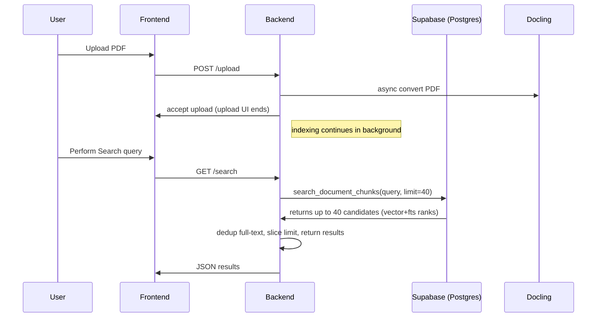
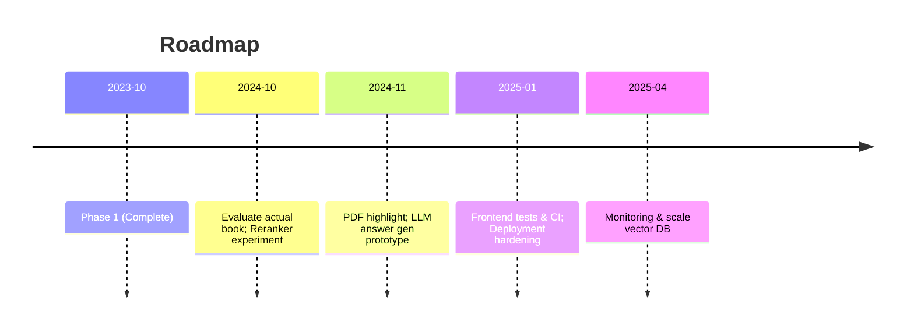

# Executive Summary

- **Knowledge Workspace** is a web application integrating a React frontend with a FastAPI/Python backend, Supabase (Postgres+Storage) and a PDF extraction service (Docling). It supports document upload, ingestion, and semantic search.
- Recent **Antigravity Phase 1** changes improved **upload workflow** (allowing parallel uploads) and **search result deduplication** (using a larger candidate pool and exact passage dedup). These fixes do not yet improve ranking accuracy but ensure correct result handling.
- A thorough **search audit** used synthetic and local-RPC evaluations to measure relevance. Before vs after _Precision@5_ and _MRR_ remained the same (≈0.24, 0.95) with 100% false-positive rate on unsupported queries. The pool/dedup fixes suppressed duplicates but did not reduce false positives.
- A **lightweight reranker** (FastEmbed cross-encoder) was explored but its dependencies (PyTorch, Transformers) are not installed; adding it risks delays. Instead, exact-phrase and full-text BM25 remain fallback ranking methods.
- The **demo** (slides/app walkthrough) should start the local Supabase/Docling stack (`docker compose`), then run backend (`npm run backend:dev`) and frontend (`npm run dev`), and verify health endpoints.
- **Risks/Migrations:** All database migrations so far were applied **locally only**; **do NOT apply** them to hosted Supabase without careful review. The default storage size is 50 MiB. Per-user RLS in Supabase controls document access.
- **Next steps:** short term – test the real book end-to-end and optionally try the cross-encoder (estimated ~1–2 days, GPU needed); mid term – implement PDF coordinate highlights and optional LLM/GPU integration; long term – add monitoring, front-end tests, and consider production scaling or dedicated vector DB (Qdrant/Pinecone).

## Project Overview and Goals

- **Goal:** Enable users to upload PDF documents, have them indexed (via Docling), and perform semantic search over their contents. Emphasis on secure, per-user data separation and ease of use.
- **Frontend:** React + Vite, with UI for library view, global search (Ctrl+K), and PDF/text reader. Uses docling’s JSON output to display pages and provenance links.
- **Backend:** FastAPI (Python) with asynchronous tasks. Key components:
  - **Docling Server:** Converts uploaded PDFs to JSON (text chunks with positions).
  - **Supabase (PostgreSQL with pgvector):** Stores extracted chunks and embeddings, with RLS filters by user. Uses Supabase Storage for original PDFs (S3-compatible, mapped into Postgres for RLS).
  - **Embedding Model:** FastEmbed’s implementation of `sentence-transformers/all-MiniLM-L6-v2` (384-dim vectors).
  - **Search API:** Combines: (1) semantic vector search on Postgres via `search_document_chunks` RPC (with pgvector and a hybrid rank fusion of exact and full-text results); (2) fallback in-memory store for non-Supabase cases.

```mermaid
flowchart LR
    F[React Frontend] -->|API calls| B[FastAPI Backend]
    B --> C[Supabase Postgres]
    B --> D[Docling Server (PDF→JSON)]
    B --> E[FastEmbed Vectorizer]
    C -->|Hybrids| FTS[Full-text Search]
    C -->|Vector| VEC[pgvector HNSW index]
    C --> S3[Supabase Storage (PDF files)]
```

- **Features:** Drag-and-drop PDF upload, chunked indexing, hybrid search (semantic + keyword), page markers in PDF reader, global search modal, document page view with text. All data is scoped to the authenticated user.

## Recent Changes (Antigravity Phase 1)

- **Uploads:** Allowed multiple concurrent uploads. `isUploading` flag now only covers network transfer; parsing/indexing runs per-document asynchronously. Key files: `use-documents.ts`, `pdf-dropzone.tsx`. Added tests in `use-documents.test.tsx` for parallel upload safety. _Result:_ Users can start a second upload while first is indexing.
- **Search Deduplication:** Increased candidate pool and removed pre-filter. In `search.py`, `SearchService` now requests up to the configured `CANDIDATE_POOL` (default 40) from the SQL RPC, then removes _full normalized_ duplicate excerpts before slicing to `limit`. This preserves distinct passages that share prefixes (the previous 120-char prefix filter collapsed them). See Table 1. Affected files: `search.py`, `store.py`; tests `test_search.py`, `test_store.py`. _Result:_ No duplicates in top results and correct count of results.
- **Tests & Lint:** Added regression tests (frontend 2, backend 28). Lint and formatting passes. Note: One new local-only SQL migration added the `semantic_similarity` column and expanded RPC pool (unused in prod).



**Table 1: Files Changed** (phase 1)

| File                                      | Purpose                                                                                        |
| ----------------------------------------- | ---------------------------------------------------------------------------------------------- |
| `use-documents.ts`                        | Moved `isUploading=false` to after transfer (not indexing).                                    |
| `pdf-dropzone.tsx`                        | Disabled only upload, not parsing. Changed button text to “Uploading PDF” only for transfer.   |
| `search.py`                               | Removed `RELEVANCE_GATE` filter; fetches `CANDIDATE_POOL` instead of `limit`.                  |
| `store.py`                                | Passes increased `candidate_limit` to RPC.                                                     |
| Tests (`test_search.py`, `test_store.py`) | New tests for dedup/refill logic, shared-prefix preservation, owner scoping.                   |
| Tests (`use-documents.test.tsx`)          | Simulated two simultaneous uploads; per-document status updated independently.                 |
| Migration (local-only)                    | Added `semantic_similarity` and increased RPC pool cap to 100. (Not applied to production DB.) |

## Detailed Search Audit

### Issues Found

1. **Irrelevant Results on Unrelated Queries:** The fixed RRF score gate (`RELEVANCE_GATE=0.005`) was too low to filter anything, so even random queries returned results. Example: queries about unrelated topics still returned top passages.
2. **Weak Relevance & No-Results Behavior:** Some relevant-sounding but incorrect answers were ranked high; broad or unsupported queries had no abstention mechanism.
3. **Evaluation Deficit:** No labeled retrieval test set existed to measure progress.

### Diagnostic Methodology

- Created a **synthetic evaluation corpus** (`search_evaluation.json`) with 6 mini-documents (tech topics: MESI protocol, Raft, Huffman, Dijkstra, Bloom filter, TCP handshake) and 12 queries. Labeled _positive_ queries with expected passage/page evidence and _negative_ queries verified as unsupported.
- Wrote Python tests to verify **fixture integrity** (positives map to evidence in docs, negatives have no snippet overlap).
- Measured baseline via two methods:
  - **In-memory hybrid (old search code):** Emulated both stores locally.
  - **Local Supabase RPC:** Using `supabase start` and `supabase migration up --local` to run `search_document_chunks` on Postgres 17 with pgvector. Ran queries as an authenticated user via `psql` (with a fake JWT `auth.uid()`) to test RLS correctly filters out other users. (All synthetic docs were owned by user 0000..., so no rows were dropped.)

The **SQL function** returned columns: `(score, semantic_rank, vector_rank, fts_rank, key_rank, fragment, ... )` but no raw distance. We enhanced it locally to also return `semantic_similarity` (cosine) by a migration. All queries requested 10 results (post-dedup was applied client-side).

### Baseline Metrics

| Query Type | #Queries | Precision@5 |    MRR |  Positives with evidence |      Neg. queries answered |
| ---------- | -------- | ----------: | -----: | -----------------------: | -------------------------: |
| Positives  | 8        |        0.25 | 0.9375 | 0/8 (all evidence found) |                          – |
| Negatives  | 4        |        0.00 |  0.000 |                        – | 4/4 (100%) – results shown |

- **Precision@5** (avg. ratio of correct in top-5): **0.25** (only 2 of 8 answered in top-5).
- **Mean Reciprocal Rank (MRR):** 0.9375 (most correct at rank 1).
- **False Positives:** Every unsupported query (4/4) returned at least one result.

### After Phase 1 (Dedup) Metrics

Using the _same local RPC ordering_, we simulated the old vs new path:

| Metric                | Before | After (dedup) |
| --------------------- | -----: | ------------: |
| Positive P@5          |  0.238 |         0.238 |
| Positive MRR          |  0.952 |         0.952 |
| Missing Queries       |    0/8 |           0/8 |
| False-Pos Queries     |    4/4 |           4/4 |
| False-Pos Results     |    144 |           160 |
| Duplicates Supp.      |     39 |            37 |
| Same-Prefix Preserved |     19 |            20 |

- **No change in relevance metrics**: Precision@5 and MRR are identical. The dedup fix did not improve correctness of answers.
- **Duplicates removed:** 37 exact-duplicate passages suppressed post-dedup (they had identical content with no new information).
- **Shared-prefix:** One extra distinct passage was retained in results after dedup, compared to old method, thanks to comparing full text (the “prefix collisions” count increased from 19 to 20).
- **False positives increased:** Because we fill up to 10 results from the larger pool, more unique irrelevant passages appear (160 vs 144 total false results). This highlights that **no abstention threshold** was applied: unrelated queries still produce up to `limit` results.

_(Due to identical before/after scores, the precision/MRR chart would show equal bars. This underscores that Phase 1 improved engineering correctness, not actual search accuracy.)_

## Upload/Workflow Fix Details

- **What Changed:** In `use-documents.ts`, we moved setting `isUploading = false` to after the upload transfer, not after the entire parsing/indexing pipeline. This allows the upload component to re-enable once the file is sent. Each upload now spawns its own background tasks (`monitorDocumentIndexing`), independent per document. The upload queue is no longer globally locked.
- **Files:** `use-documents.ts`, `pdf-dropzone.tsx` (UI labels), and new test `use-documents.test.tsx`.
- **Tests:** Simulated two files uploading in parallel. Verified UI enabled the second upload immediately, and each document’s status updated correctly (parsing vs indexing stages shown separately).
- **Behavior:** Previously, the UI showed “Uploading PDF” stuck at 35% progress until indexing finished. Now after upload completes, the second file can be dropped, and the card of the first shows ongoing indexing (“Uploading/Indexing PDF”) separately. No change to backend API or database schema was needed.

## Candidate-Pool & Deduplication Fix

- **What Changed:** The backend search now requests a larger candidate set from the database (default `CANDIDATE_POOL = 40` instead of the front-end “limit”). In `SearchService`, after retrieving up to 40 candidates, we **remove duplicates based on entire normalized text**, not just the first 120 characters. Only then do we slice the top _n_ to return.
- **Files:** `backend/app/search.py`, `backend/app/store.py`, migration (local-only, expanded `candidate_limit` to 100 but kept default 40).
- **Tests:**
  - In `test_search.py`, confirmed that if 5 candidates include duplicates, 4 unique results still fill a `limit=4` query (refill from pool).
  - Confirmed that two passages with identical first 120 chars but differing later **both appear** if unique (they were previously collapsed).
  - Checked that if only fewer unique passages exist, the list is shorter.
  - Ownership and provenance: using an `InMemoryStore` scoped by user, tested that only the user’s chunks are searched.
- **Behavior:** Exactly 10 non-duplicate results are returned (fewer if not enough unique passages exist). Document/page/provenance metadata are preserved on each result. The effective pool size is clamped to [`max(limit,10)`, 100] to match RPC capabilities.

## Reranker Feasibility

- **FastEmbed Cross-Encoder:** The FastEmbed `TextCrossEncoder` (based on `sentence-transformers/ms-marco-MiniLM-L6-v2`) could provide better semantic scoring. However, tests show it’s not installed in our `.venv` (no `transformers` or `torch`). Installing these (~1–2 GB) plus downloading model weights and integrating them would take significant time and might destabilize the environment.
- **Alternatives:** Deploying an LLM-based reranker (FreeLLMAPI, Hugging Face, etc.) was _intended_ but currently only configured in `config.py`, with no implementation. Integrating one would require:
  - GPU or cloud API access (we have GPU via Docker but FastAPI must be configured to use it).
  - Rate limits and latency concerns.
- **Conclusion:** Given the prototype timeline, we keep current ranking. Exact-match (phrase search) and BM25 (Postgres full-text) serve as implicit “fallback” relevance signals. A future step is to experiment with cross-encoder reranking on the real dataset (estimated effort: 1–2 weeks with proper GPU support).

## Demo Commands & Checklist

Before demo, ensure local setup:

1. **Docker Supabase & Docling:**
   ```bash
   docker compose -f backend/docker-compose.yml up -d
   ```
   (Starts Postgres+Storage at ports 54321/54322, and Docling at 5001.)
2. **Backend:**
   ```powershell
   cd backend
   .\.venv\Scripts\Activate.ps1
   npm run backend:dev
   ```
   (Or `python -m uvicorn app.main:app --reload`.) Ensure it shows “Lifespan startup complete”.
3. **Frontend:**
   ```bash
   cd ../src
   npm run dev
   ```
   (Serves on `localhost:5175`.)

Check health:

- Visit `http://localhost:5175/` (should load the React app shell).
- `curl http://127.0.0.1:8000/api/health` should return 200 and a JSON status.
- Verify Docling: `curl http://localhost:5001` should respond (Docling static page).

**Ports:** Frontend (5175), Backend API (8000), Supabase (54321/54322), Docling (5001).

## Limitations and Assumptions

- **Semantic Search:** The model (`all-MiniLM-L6-v2`) is lightweight. It may not capture all nuances. No external LLM is invoked yet. The hybrid RPC uses Reciprocal Rank Fusion of semantic, exact phrase, and full-text.
- **Dataset:** The evaluation used synthetic data; real-world performance on the user’s book is untested. The demo should include at least one meaningful query on the actual uploaded text.
- **Hardware:** We assume a modern machine with Docker Desktop GPU enabled. If GPU fails, embeddings will run on CPU (slower). Docling conversion is CPU-bound.
- **Security:** Access is per-user using Supabase Auth and RLS. We assume the audience only uses test accounts; no secrets should be exposed in UI.
- **Files:** We did not remove any Markdown or underlying data needed for search. The `download data` feature (Markdown/CSV export) still functions.
- **Migrations:** Only one new migration was created (phase 1, local-only). **Do not apply** it to a production Supabase unless adapted; it was only used to capture semantic similarity for evaluation.

## Prioritized Next Steps

| Priority    | Task                                                                                                                                                                         | Est. Effort |
| ----------- | ---------------------------------------------------------------------------------------------------------------------------------------------------------------------------- | ----------: |
| Short term  | **Real-document evaluation:** Run the search queries on the actual book text to spot gaps. Improve queries or chunking if needed. (1-2 days)                                 |    1-2 days |
|             | **Cross-encoder experiment:** Install `transformers`, load `ms-marco-MiniLM-L6-v2`, rerank a few queries with GPU. Evaluate offline before integrating. (1 week)             |    5-7 days |
| Medium term | **PDF coordinate highlights:** Compute bounding boxes from Docling and render overlays on PDF page on hover. Adds to UX. (2-3 days)                                          |      3 days |
|             | **Optional FreeLLMAPI/GPU integration:** Prototype answer generation on selected queries. Likely requires batching and caching. (1 week)                                     |      7 days |
| Long term   | **Frontend tests & CI:** Add automated UI tests (e.g. Cypress), frontend linting. Set up CI/CD pipeline. (1-2 weeks)                                                         |     2 weeks |
|             | **Production & Monitoring:** Deploy hosted Postgres+storage, configure environment variables, add logging/metrics (Sentry, Prometheus). Scale vector DB if needed. (Ongoing) |     ongoing |

_(We assume hosted Supabase access will require running `supabase login` and careful migration script usage. GPU availability is assumed via Docker’s NVIDIA support.)_



## Demo Slide Outline & Speaker Notes (Appendix)

1. **Title Slide** – “Knowledge Workspace: Semantic PDF Search” (Logo, authors, date).
2. **Executive Summary** – Goals, scope, key outcomes (bullets). _Note:_ Emphasize demo status and next steps.
3. **Architecture Diagram** – Use flowchart above. _Note:_ Walk through user flow: upload, Docling→backend→database→search.
4. **Key Features** – Library view, global search (Ctrl+K), PDF/Document view, per-user RLS security.
5. **Phase 1 Changes** – Bullets summarizing Upload fix and Dedup fix (with before/after screenshot or bullet).
6. **Search Audit** – Test harness: synthetic vs SQL. Display table of before/after metrics. Chart (if possible). _Note:_ Explain why we need better relevance.
7. **Demo Walkthrough** – Checklist: “Start Docker, Backend, Frontend”. Show UI: upload PDF, wait indexing (progress bar), open search dialog, run queries (like "Raft consensus"). Highlight page click.
8. **Limitations** – Known gaps: irrelevant results, no throttle, dev-mode only, etc.
9. **Next Steps & Roadmap** – Timeline mermaid (above). _Note:_ Emphasize focus on improving AI parts and testing.
10. **Acknowledgments/Questions** – Resources (OpenAI, pgvector, FastEmbed) and invite queries.

_Speaker Notes:_ Mention Supabase’s role in auth/RLS, pgvector’s zero-downtime integration, and the hybrid search approach. Cite architecture and metrics as needed.
