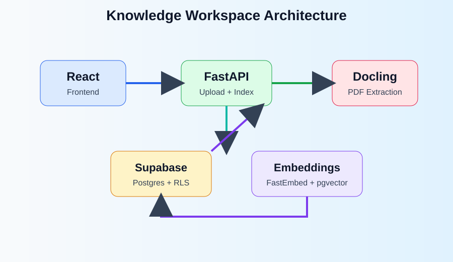
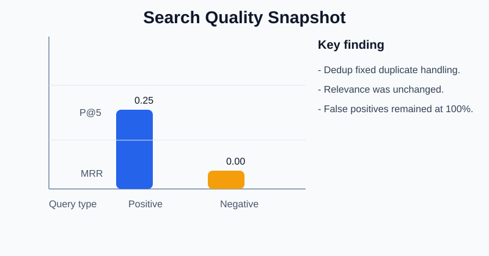
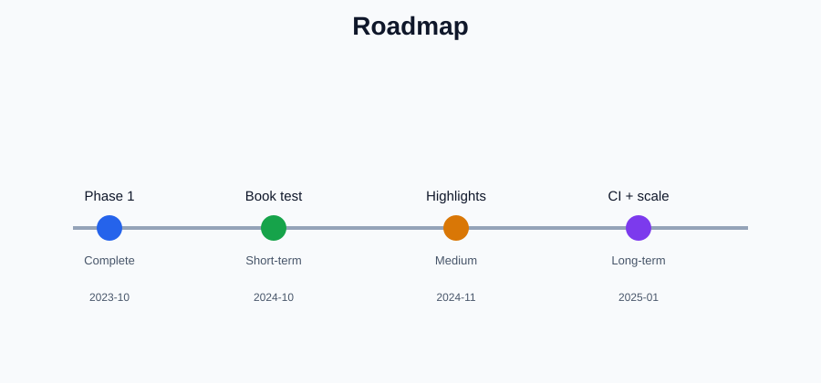

<!-- _class: lead -->

# Knowledge Workspace

## Semantic PDF Search and Research Workspace

### React + FastAPI + Supabase + Docling

<div class="muted">
Built as a research-focused knowledge system for reading, uploading, indexing, and retrieving PDF content securely.
</div>

<div class="footer">October 2026</div>

---

## 1. Project Vision

The goal was to build a research workspace that helps users:

- upload and organize PDF documents,
- convert them into searchable content,
- search by meaning, not just exact keywords,
- keep documents and results scoped to a single authenticated user,
- read PDF content with page-aware provenance and context.

<div class="two-col">
<div>

### Core value

- Faster knowledge retrieval from books and notes
- Better document browsing in one interface
- Clean, user-scoped access control
- Extensible future AI layer

</div>
<div>

### Product intent

- Library view
- Reader and document viewer
- Global search
- Notes and settings shell
- Secure auth and document ownership

</div>
</div>

---

## 2. Original Product Goals

### First Milestone goals

- Build a premium reading experience with a calm, research-focused UI.
- Add library, reader, search, notes, login, and settings screens.
- Keep the product clearly marked as a demo.
- Prepare the app for future Supabase integration, embeddings, and AI features.

### Current ingestion scope

- Upload PDFs from the Library
- Convert through Docling Serve via FastAPI
- Keep job states: queued, processing, completed, failed
- Preserve headings and page provenance
- Show a clear demo boundary before real AI answers or chat

---

## 3. System Architecture



### End-to-end flow

1. User uploads a PDF in the frontend.
2. FastAPI validates and stages the file.
3. Docling Serve converts the PDF asynchronously.
4. Extracted content is normalized and chunked.
5. Embeddings are stored with pgvector metadata.
6. Search fuses semantic, phrase, and full-text results.

---

## 4. Key Technical Stack

<div class="three-col">
<div>

### Frontend

- React + TypeScript + Vite
- Search UI and PDF reader shell
- Library, global search, notes, settings

</div>
<div>

### Backend

- FastAPI service for upload, indexing, and search
- Async processing pipeline
- Validation and job state tracking

</div>
<div>

### Data layer

- Supabase Auth
- Postgres + pgvector
- Storage bucket for private PDFs
- RLS for user scope

</div>
</div>

### Supporting tools

- Docling Serve for PDF extraction
- FastEmbed for embeddings
- Hybrid search with phrase + full-text + vector fusion

---

## 5. Retrieval and Search Architecture

- Semantic vector retrieval is performed through pgvector.
- Full-text search uses Postgres `tsvector` and GIN index.
- Exact phrase matching adds a strong retrieval signal.
- Reciprocal Rank Fusion combines all three methods.

### Hybrid retrieval model

$$
\text{RRF}(d) = \sum_{m \in M} \frac{1}{k + \text{rank}_m(d)}
$$

This gives a unified ranking score from:

- vector similarity,
- exact phrase search,
- full-text retrieval.

---

## 6. User Experience Flow

### From upload to answerable query

1. Open the Library.
2. Drop or select a PDF.
3. Wait for conversion and indexing.
4. Search in the global search dialog.
5. View excerpts with page and provenance metadata.
6. Open the reader and navigate to relevant pages.

### Security model

- every chunk and PDF is scoped to the authenticated user,
- Supabase RLS prevents cross-user access,
- FastAPI derives ownership from verified auth tokens.

---

## 7. What Changed in Phase 1

### Upload workflow improvement

- `isUploading` was moved to cover only the transfer phase.
- Indexing runs independently per file.
- Multiple uploads can proceed without one blocking the other.

### Search deduplication fix

- candidate pool increased before final slicing,
- exact normalized duplicates were removed,
- shared-prefix passages were preserved correctly,
- top results remained non-duplicate and count-correct.

### Result

- smoother UX for parallel uploads,
- better result correctness in top rankings,
- stronger engineering stability without changing the core product goal.

---

## 8. Search Audit and Quality Findings



### Issues discovered

- unsupported queries still returned results,
- relevance was weak on some broad or unrelated questions,
- there was no reliable labeled evaluation set.

### Evaluation approach

- synthetic corpus created for positive and negative queries,
- local Supabase RPC checks on pgvector + RLS,
- measured before and after dedup logic.

### Summary

- Precision@5 stayed roughly the same after dedup.
- The fix improved duplicate handling, but not ranking quality.
- This was an engineering correctness fix rather than a retrieval-quality breakthrough.

---

## 9. Search Quality Metrics

| Query Type | #Queries | Precision@5 |  MRR | False Positive Rate |
| ---------- | -------: | ----------: | ---: | ------------------: |
| Positives  |        8 |        0.25 | 0.94 |                   — |
| Negatives  |        4 |        0.00 | 0.00 |                100% |

### Interpretation

- Most correct answers appeared at rank 1.
- But many unsupported queries still produced results.
- This shows the need for a stronger relevance gate, reranker, or abstention policy.

### Important takeaway

> The project reached a stable technical base, but real ranking quality remains the next step.

---

## 10. Demo Workflow

### Local setup checklist

```bash
docker compose -f backend/docker-compose.yml up -d
cd backend
npm run backend:dev
cd ../src
npm run dev
```

### Health checks

- Frontend: `http://localhost:5175`
- Backend: `http://127.0.0.1:8000/api/health`
- Docling: `http://localhost:5001`

### Demo flow

1. Upload a PDF
2. Wait for indexing completion
3. Open the global search dialog
4. Run a document-specific query
5. Click the result to view the page and source context

---

## 11. Roadmap and Next Steps



### Short term

- Real-document evaluation on actual book PDFs
- Search improvements and query validation
- Optional reranker experiment with GPU support

### Medium term

- PDF coordinate highlights on reader pages
- LLM or GPU-assisted answer prototype
- Stronger UX and document provenance features

### Long term

- Frontend testing and CI
- Production hardening
- Monitoring and scaling for real deployments

---

## 12. Final Takeaways

- This project successfully combines a strong UI, secure storage, structured ingestion, and hybrid retrieval.
- The architecture is sound and modular enough for future improvements.
- Search quality is the main remaining technical challenge.
- The next milestone is not just more features, but better relevance and trustworthiness.

### Closing message

Knowledge Workspace is already a strong prototype foundation for an AI-powered research assistant, with a clear path from PDF ingestion to semantic retrieval to richer document understanding.

---

## Thank You

### Questions?

- Project architecture
- Search quality and retrieval strategy
- Future enhancements
- Demo walkthrough and next milestones

<div class="footer">Knowledge Workspace • Semantic PDF Search</div>
